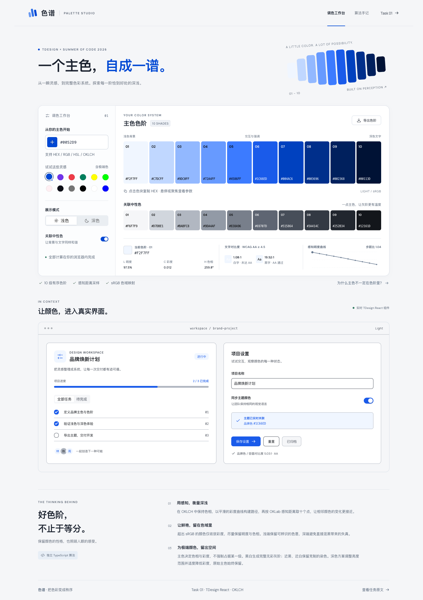

# 色谱 · Palette Studio

输入一个主色，生成由浅到深的十级色阶。本项目实现 [TDesign 犀牛鸟 2026 Task 1「当一次“调色大师”」](https://tdesign.gtimg.com/docs/summer-of-code-2026/tdesign-task.html#task-one)，包含深色模式与关联中性色两项扩展。

界面支持颜色输入与拾色、预设切换、色值复制、对比度查看，以及 CSS / JSON 导出；通过 TDesign 组件预览配色效果。技术栈为 React 19、TypeScript 6、Vite 8 和 Culori，色彩计算全部在浏览器本地完成，无需后端或环境变量。



## 本地运行

需要 Node.js 22.12+ 和 Bun 1.3.14+。在项目根目录执行：

```bash
bun install --frozen-lockfile
bun run dev
```

打开终端显示的地址，默认是 `http://localhost:5173`。输入主色或选择预设，切换浅色 / 深色，点击色块复制 HEX，通过「导出色阶」下载 CSS 或 JSON。

预览中的项目卡片用于体验组件状态，数据仅保存在内存中，刷新后重置。

## 核心 API

[`src/lib/palette.ts`](src/lib/palette.ts) 是独立 TypeScript 模块，只依赖 Culori，不依赖 React 或 DOM。以下示例可在项目根目录的 TypeScript 脚本中运行：

```ts
import { generatePalette, generateTheme } from "./src/lib/palette";
import { exportTheme } from "./src/lib/theme";

const light = generatePalette("#0052D9");
const dark = generatePalette("#0052D9", { mode: "dark" });
const neutral = generatePalette("#0052D9", { neutral: true });

const theme = generateTheme("#0052D9");
// theme: { source, light, dark, neutralLight, neutralDark }
const css = exportTheme(theme, "css");
const json = exportTheme(theme, "json");
```

输入与输出约定：

- 支持 HEX、RGB、HSL、OKLCH、CSS 命名色等不透明颜色；广色域输入先映射到 sRGB。非法输入、透明色及依赖上下文的颜色抛出 `ColorInputError`。
- 每套色阶返回只读十元素元组，格式为大写 `#RRGGBB`，浅色与深色模式均按 1 最浅、10 最深排列。
- 主色决定色相和彩度，不保证精确出现在某一级；归一化后的原色保存在 `theme.source`。
- CSS / JSON 均导出四套色阶。CSS 包含 `:root` 与 `[data-theme="dark"]` 变量，应在 TDesign 样式之后加载；语义变量覆盖本项目预览，未包含完整的成功、警告、错误等状态色主题。

## 源码阅读入口

建议先看色阶引擎与算法说明，再看主题映射和界面：

| 文件                                                 | 职责                                         |
| ---------------------------------------------------- | -------------------------------------------- |
| [`src/lib/palette.ts`](src/lib/palette.ts)           | 颜色解析、色域映射、十级色阶生成与对比度计算 |
| [`src/lib/theme.ts`](src/lib/theme.ts)               | 语义颜色、TDesign 变量与 CSS / JSON 导出     |
| [`src/App.tsx`](src/App.tsx)                         | 工作台状态、输入与模式切换                   |
| [`src/components/`](src/components/)                 | 色阶、详情、组件预览与导出弹窗               |
| [`src/lib/palette.test.ts`](src/lib/palette.test.ts) | 算法边界、对比度与导出测试                   |

[算法说明](docs/algorithm.md) 解释 OKLCH 路径、OKLab 等弧长采样和极端颜色取舍；[验证说明](docs/verification.md) 列出测试范围、浏览器复跑方法及界面截图。

## 检查与构建

运行完整检查，再预览生产构建：

```bash
bun run check
bun run preview
```

`check` 依次执行 Oxlint、Oxfmt、Vitest、TypeScript 检查和 Vite 构建，产物位于 `dist/`。`preview` 默认地址为 `http://localhost:4173`。只运行算法与导出测试时使用 `bun run test`。

项目可作为静态站点部署。[`vercel.json`](vercel.json) 已配置安装命令 `bun install --frozen-lockfile`、构建命令 `bun run build` 和输出目录 `dist`。
